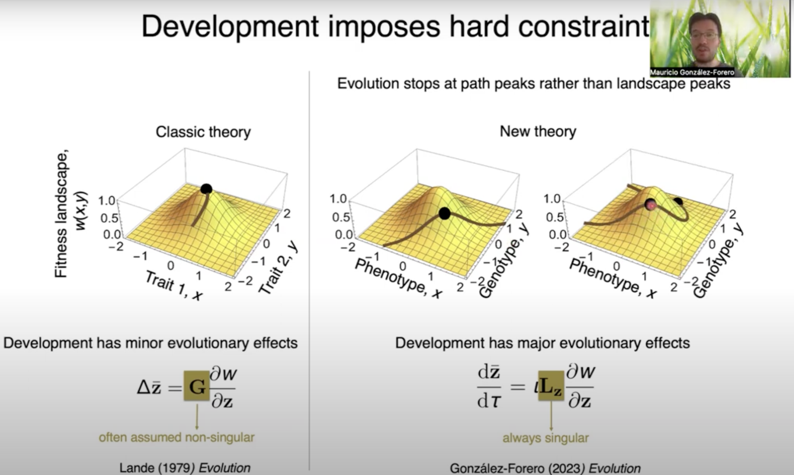

I am a mathematical evolutionary biologist and Senior Postdoctoral Fellow at the [Konrad Lorenz Institute for Evolution and Cognition Research (KLI)](https://www.kli.ac.at/content/en/home) in Klosterneuburg, Austria. I work at the interface of biology, mathematics, and anthropology.
{: .lead}

I develop general mathematical theory that treats development and evolution together (evo-devo dynamics). Two questions drive my research: how development and evolution interact, and why the human brain size evolved.

Along the way, I have derived formulas for how a system responds to perturbation, and applied them to questions in human demography and behaviour. Earlier work addressed the evolution of eusociality and the definition of species. More on the [Research](research) page.

## Contact

mauricio.gonzalez-forero [at] kli.ac.at  
Konrad Lorenz Institute for Evolution and Cognition Research  
Martinstraße 12, 3400 Klosterneuburg, Austria

<ul class="profiles">
  <li><a href="https://scholar.google.com/citations?user=WIXuy2kAAAAJ">Google Scholar</a></li>
  <li><a href="https://orcid.org/0000-0003-1015-3089">ORCID</a></li>
  <li><a href="https://bsky.app/profile/mauriciogforero.bsky.social">Bluesky</a></li>
  <li><a href="https://fediscience.org/@MauricioGForero">Mastodon</a></li>
  <li><a href="https://www.linkedin.com/in/mauricio-gonzalez-forero/">LinkedIn</a></li>
  <li><a href="https://www.researchgate.net/profile/Mauricio-Gonzalez-Forero">ResearchGate</a></li>
</ul>

## Research overview in 15 minutes

<figure class="video">

<figcaption>Virtual talk at the 2024 Evolution conference (YouTube).</figcaption>
</figure>
