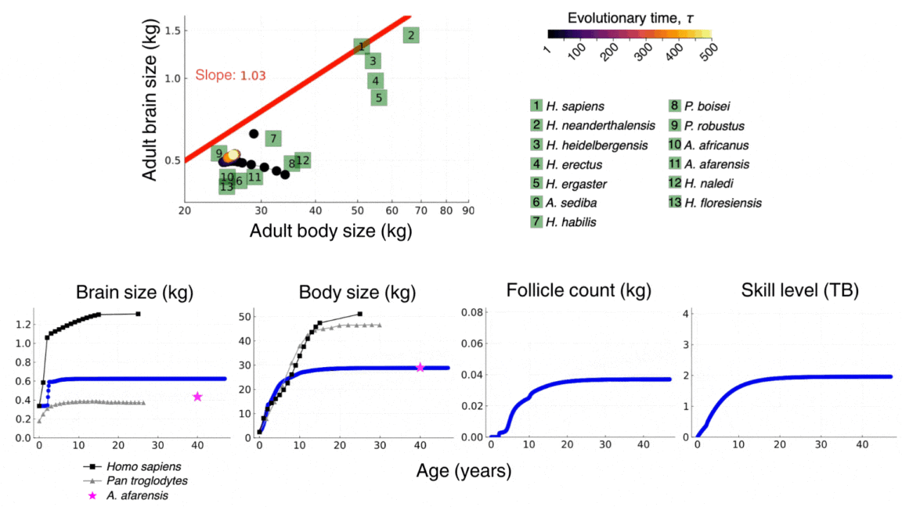
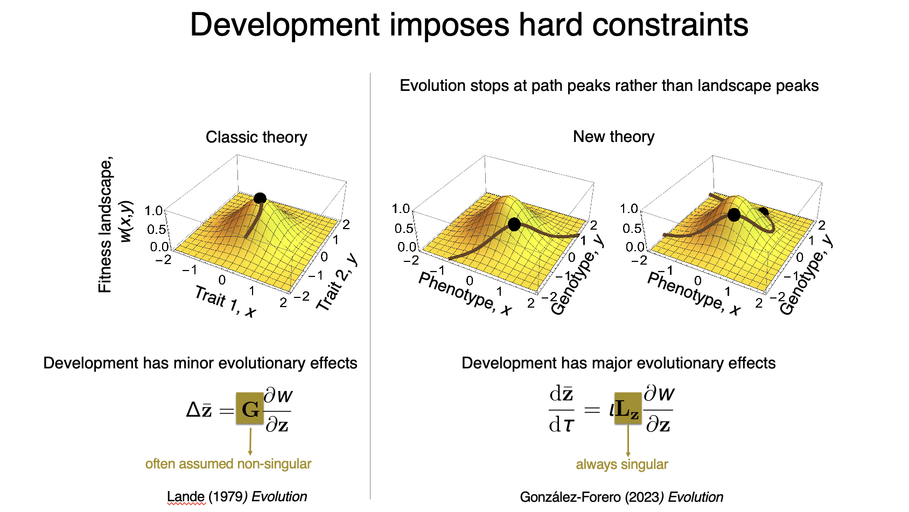
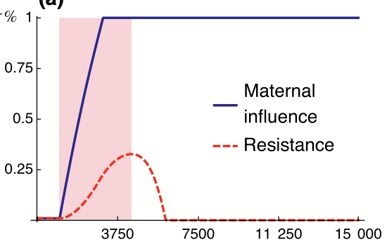
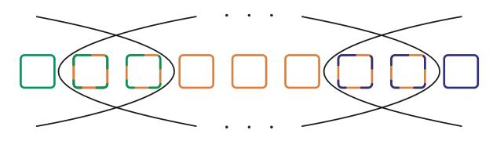

# Research

## Current directions

- **A mathematical synthesis of genetics, development, and evolution.** I am extending the evo-devo dynamics framework to include sexual reproduction and discrete genotypes ([preprint](https://doi.org/10.64898/2026.02.25.707927)).
- **Simulation-based inference.** I am building inference tools that combine evo-devo dynamics with data to identify the causes of taxon-specific traits, starting with human brain size, and that others can apply to their own study organisms. The theory also predicts the effects of developmental interventions.

## Human brain evolution

Brains have evolved into a stunning diversity across the animal kingdom, giving rise to an even more stunning diversity in behaviour. What drives brain evolution? We developed a mathematical model to help address this question ([González-Forero, Faulwasser, and Lehmann, 2017](https://journals.plos.org/ploscompbiol/article?id=10.1371/journal.pcbi.1005380)).

Using this model, we found that cognitive ability and brain mass can be mechanistically related by a simple equation. Extending this model to social interactions, we also found causal, computational evidence suggesting that human brain expansion may have been driven by ecological and cultural factors, rather than social factors such as cooperation and competition, contrasting with dominant hypotheses ([González-Forero and Gardner, 2018](https://rdcu.be/O1Vc)).

In a further extension of this work modelling the developmental and evolutionary (evo-devo) dynamics of hominin brain size, I found that, counterintuitively, the sharp expansion in brain size in the human lineage may have been a by-product of selection for mature ovarian follicles. In this model, the role of ecology and culture is not to increase selection for brain size, as often assumed, but to generate a genetic correlation between ovarian follicles and brain size, and this correlation causes human brain expansion ([González-Forero, 2024b](https://www.nature.com/articles/s41562-024-01887-8)). This turns out to be consistent with empirical evidence of genetic correlations between the brain and reproductive tissues in humans ([González-Forero and Gómez-Robles, 2025](https://doi.org/10.1098/rstb.2024.0114)).

<figure>

<figcaption>Evolutionary and developmental dynamics of the human brain as predicted by the model: the evolution of adult brain and body sizes from australopithecine to sapiens scales, of an adolescent growth spurt, of a long childhood period, and of a doubling in adult skill level. From <a href="https://www.nature.com/articles/s41562-024-01887-8">González-Forero, 2024b</a>.</figcaption>
</figure>

## How development affects evolution

The modern evolutionary synthesis of the 1930s and 1940s unified Darwinian evolution and Mendelian inheritance. Since then, many researchers have called for an analogous synthesis between evolutionary and developmental biology, arguing that the lack of such a synthesis has limited evolutionary understanding.

I formulated a mathematical framework that integrates evolutionary and developmental dynamics, yielding insights into how development affects evolution ([González-Forero, 2024a](https://doi.org/10.1016/j.tpb.2023.11.003)). The framework sharpens Wright's principle, according to which adaptation by natural selection occurs such that the population climbs the fitness landscape. It shows that development provides the admissible evolutionary path and invariably induces hard constraints on adaptation. This means that evolution stops at such path peaks rather than at the peaks of the fitness landscape, as commonly assumed. Since changing development changes the path and its peaks, changing development alone changes evolutionary outcomes even without changing selection (the landscape). Consequently, development has major evolutionary effects, contrasting with long-held views ([González-Forero, 2023](https://doi.org/10.1093/evolut/qpac003)).

An important illustration of this result is that changing development alone (the path), without changing selection (the landscape), can lead to the evolution of the massive human brain size from australopithecine ancestors ([González-Forero, 2024b](https://www.nature.com/articles/s41562-024-01887-8)).

<figure>

<figcaption>Left: classic theory of phenotypic evolution by natural selection according to the Lande equation, where traits evolve up the fitness landscape and reach a local fitness peak; development only transiently diverts evolution by generating genetic covariation. Right: the new theory, where describing phenotypic evolution requires describing the evolution of the underlying genotype. Development relates genotype and phenotype along the indicated path, so there is genetic variation only along that path and evolution stops at peaks of the path rather than of the landscape.</figcaption>
</figure>

## Sensitivity of dynamical systems

To analyse evo-devo dynamics, I derived analytical formulas for how recurrence equations respond to perturbation, which are analytical versions of backpropagation, together with a gradient-ascent method for constrained dynamic optimization ([González-Forero, 2024a](https://doi.org/10.1016/j.tpb.2023.11.003)). These formulas apply well beyond evolution. With collaborators, I have used them to compute how health interventions change healthy life expectancy ([Riffe, Villavicencio, and González-Forero, preprint](https://dx.doi.org/10.4054/MPIDR-WP-2024-014)) and to quantify mechanistically the effects of genes, environment, and development on human behaviour ([González-Forero and Gómez-Robles, preprint](https://doi.org/10.1101/2025.03.17.643651)).

## Social evolution

In major evolutionary transitions, groups of individuals become higher-level individuals, which has had major effects on life on Earth. What causes such major transitions?

We developed mathematical models to study a classic hypothesis that posits that one such major transition, eusociality, arose from ancestral maternal manipulation. The hypothesis suggests that workers in eusocial organisms evolved because mothers manipulate their offspring to become helpers. Although this hypothesis attracted interest in the 1970s, evidence has since been interpreted as rejecting it, because manipulation was thought to lead offspring to resist, whereas eusocial offspring seem to help voluntarily. We found that manipulation may evolve while resistance fails to evolve for various reasons, so eusociality can evolve from ancestral manipulation, yielding voluntarily helping offspring, consistent with various patterns observed in eusocial taxa (e.g., [González-Forero and Peña, 2021](https://doi.org/10.1098/rspb.2021.0386)).

<figure>

<figcaption>Conflict dissolution: resistance to maternal manipulation is first selected for, but this triggers the evolution of other traits that increase the benefit of helping, so resistance becomes selected against and disappears. From <a href="https://doi.org/10.1111/jeb.12744">González-Forero, 2014</a>.</figcaption>
</figure>

## What is a species?

Species are key units for evolutionary inference and conservation policies, but they are infamously difficult to define. I developed a mathematical formalization of the biological species concept and explored its consequences.

During my undergraduate thesis, I found that one of four mathematical interpretations of this concept overcomes various difficulties of the verbal concept, but in doing so, populations can belong to multiple species ([González-Forero, 2009](FullJTB09.pdf)).

<figure>

<figcaption>Overlapping species: each square is a population, and two populations with a common colour are reproductively compatible. From <a href="https://doi.org/10.1016/j.jtbi.2008.09.016">González-Forero, 2009</a>.</figcaption>
</figure>
